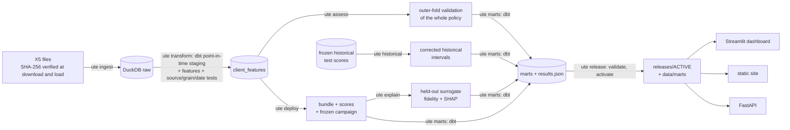

# uplift-targeting-engine

**Causal uplift modeling for promotion targeting.** The pipeline estimates how much an SMS promotion
*changes* each customer's chance of buying, turns that into a cost-aware send rule, validates the
**whole rule** out of fold, and serves the result through a warehouse, an API and a BI dashboard.


**Dashboard snapshot:** https://nirmalkumar31.github.io/uplift-targeting-engine/

Data: the public [X5 RetailHero](https://ods.ai/competitions/x5-retailhero-uplift-modeling)
randomised experiment (400k loyalty-card holders, 45.8M purchase lines; 200k customers of whom a
random half received the SMS). Dataset terms are the competition's; the MIT license covers this
code only.

> **Audit and remediation.** An independent audit ([docs/AUDIT_2026-10-25.md](docs/AUDIT_2026-10-25.md))
> found 13 issues in the first version: frozen-response bootstrap intervals, an unvalidated deployed
> rule, a reused "locked" test, leaky guardrails, API and dashboard defects. Every finding is mapped to
> its fix, checks and remaining limitations in [docs/AUDIT_REMEDIATION.md](docs/AUDIT_REMEDIATION.md).
> Pre-remediation results are preserved under a hash manifest in [docs/evidence/](docs/evidence/).

## The idea

A response model texts the people most likely to buy, and many of them would have bought anyway.
Uplift modeling ranks customers by the *difference* the message makes:
τ(x) = P(buy | x, SMS) − P(buy | x, no SMS). The deployed rule texts a customer when the
calibrated effect × an **assumed** value per additional buyer exceeds the SMS cost.

## Results

Three kinds of evidence appear below. They are **not interchangeable**, and none is independent
confirmation:
1. **Outer-fold validation** of the complete policy (selection + calibration + threshold), on
   customers that were also used during earlier exploration.
2. **The historical test split**, which was scored repeatedly and reused.
3. **Model-based projections** for the full customer base.

<!-- results:start -->
_Generated from `data/marts/results.json` (release `rel-20261025T191554`, policy `06c39b17c1e9d923`). Economics are assumptions: SMS ₽3.00, ₽105 per additional buyer (break-even uplift 2.85%)._

**1 · Outer-fold retrospective validation of the deployed policy** (all 200,039 labelled experiment customers, each validated once by a procedure fitted without its fold; retrospective internal validation on customers already used during earlier exploration; not independent confirmation).

| Policy | Customers texted | Value per 1,000 customers [95% CI] |
|---|---|---|
| Deployed policy (calibrated threshold) | 33.7% | ₽1,156 [₽901, ₽1,435] |
| Response model, own best share | 89.8% | ₽455 [₽79, ₽885] |
| Random, same share (expected) | 33.7% | ₽168 [₽24, ₽314] |
| Text everyone | 100.0% | ₽500 [₽72, ₽933] |
| Text nobody | 0.0% | ₽0 [₽0, ₽0] |

| Paired difference (same draws) | Per 1,000 [95% CI] | Share of draws > 0 |
|---|---|---|
| Deployed − text everyone | ₽656 [₽303, ₽1,029] | 1.000 |
| Deployed − text nobody | ₽1,156 [₽901, ₽1,435] | 1.000 |
| Deployed − response model, own best share | ₽700 [₽349, ₽1,090] | 1.000 |

Intervals: 500 customer-within-arm bootstrap draws for the fixed fitted policies; they exclude model-fitting and selection uncertainty. Deployed value by outer fold ranged ₽812 to ₽1,321 per 1,000 (folds share training data). Champion by fold: s_learner, x_learner, s_learner, s_learner, ensemble:dr_learner+s_learner+x_learner.

**2 · Historical reused test** (the 2026-10-24 bundle; not independent confirmation).

| Model | Qini AUC [95% CI] | Uplift @10% [95% CI] |
|---|---|---|
| champion | +0.0164 [+0.0102, +0.0224] | +11.9% [+8.7%, +14.9%] |
| response | -0.0054 [-0.0108, +0.0004] | +0.9% [-0.2%, +2.0%] |
| random_draw | -0.0015 [-0.0073, +0.0058] | +2.9% [+0.3%, +5.9%] |

Historical 41% policy − text everyone: ₽514 [−₽223, ₽1,271] per 1,000 (share of draws > 0: 0.914).

**3 · Deployment projection** (model-based scenario, not an observed result): 400,162 customers scored, 107,013 eligible, 96,182 to text and 10,831 held out (10% random holdout); projected 6,229 additional buyers and ₽367,477 among those texted, vs ₽200,025 for texting everyone under the same assumptions.
<!-- results:end -->

What the numbers do and don't cover is in [docs/methodology.md](docs/methodology.md).
Interval coverage of the bootstrap was checked by simulation
([docs/evidence/bootstrap_coverage_diagnostic.json](docs/evidence/bootstrap_coverage_diagnostic.json)).

## Architecture



| Layer | What it does |
|---|---|
| **Ingest** (`ingest.py`) | download; SHA-256 checked at download *and* at the load boundary; typed load of 45.8M rows in ~18 s |
| **Warehouse** (`dbt/`) | one configured `as_of` cutoff; every purchase feature reads a `< as_of` input; tests fail the build on future/null timestamps, contradictory transaction fields, orphan keys, train/test overlap; counted cleaning rules (`stg_data_quality`) |
| **Learners** (`models/learners.py`) | S, T, X, class transformation (arm-reweighted), DR, top-k ensemble; response and random baselines |
| **Procedure** (`pipeline.fit_procedure`) | inner-CV selection → OOF-fitted isotonic calibrator → refit → strict cost/margin rule; response comparator optimised on training data too |
| **Inference** (`evaluation/metrics.py`, `policy.py`) | customer-within-arm bootstrap with shared draws; validated metric contracts; sklift reference cases; policy values with paired differences vs blanket, no-send, response and expected random |
| **Releases** (`lineage.py`, `release.py`) | every run records commit/dirty, source/config/data/feature/environment fingerprints; run-keyed history; validated atomic activation |
| **Serving** (`api.py`) | typed feature contract (422 on unusable records); `/score` = economic eligibility only; `/campaigns/{id}/authorize` enforces the frozen holdout; `/health` vs `/ready` |
| **BI** (`dashboard/`, `scripts/build_site.py`) | 7-page Streamlit app and a static snapshot, every number labelled by evidence source and read from `results.json` |

## Quickstart (source checkout)

```bash
uv sync --locked --all-extras            # CPython 3.12, uv 0.13.x
uv run ute run                           # ingest -> transform -> assess -> deploy -> historical
                                         #   -> explain -> marts -> release (~1 h on a laptop)
uv run streamlit run dashboard/app.py    # dashboard on the active release
uv run uvicorn uplift_engine.api:app     # API on the active release (/docs)
uv run ute export-send-list send.csv     # action == send only; holdout never included
```

The active release's marts are committed in `data/marts/`, so the dashboard runs right after
`uv sync`. The API needs a generated release (`releases/`, gitignored): without one it is alive
(`/health`) but not ready (`/ready` → 503). `ute historical` needs the local evidence snapshot
(`snapshots/`, gitignored, verified against its committed manifest); on a fresh clone without it,
that stage fails clearly and a release cannot be activated.

**Execution modes.** Supported: a source checkout, or `UTE_ROOT` pointing at one. The wheel contains
the Python package only (configs and dbt are project files), so an installed wheel alone stops with
a clear "cannot find the project root" message. **Docker:** `docker compose up --build` serves the
dashboard from committed marts, and the API with `./releases` mounted read-only.

## Testing

```bash
uv run pytest            # unit + raw-fixture end-to-end (ingest -> dbt -> ... -> release -> API/dashboard/site)
uv run --isolated --resolution lowest-direct --all-extras --group dev pytest   # lowest supported deps
uv run python scripts/build_fixture_release.py /tmp/fx && \
  uv run python scripts/build_site.py --marts /tmp/fx/marts --out /tmp/site/index.html && \
  uv run --group browser python scripts/browser_check.py --site /tmp/site/index.html
```

The end-to-end tests build a miniature dataset in the real raw schema. It includes line items that
repeat basket totals, a 16-year-old, a future redemption and redemption-before-issue, and the
variants that must fail the dbt build (future transaction, contradictory basket fields, unmatched
product, null timestamp). CI runs lint, the full suite on locked and on lowest dependencies, a
real-Chrome check of the static site, and the Docker image.

## Limitations

- **Economics are assumptions.** The constant basket × gross margin is an assumed utility, not an
  identified causal revenue effect. The simulator recomputes everything for other values.
- **No independent confirmation.** The outer-fold validation reuses customers seen during earlier
  exploration, and the historical test split was reused. A new campaign with its holdout group
  is the real test.
- **Intervals cover customer sampling for fixed fitted policies.** They exclude model-fitting and
  selection uncertainty, and curve bands are pointwise.
- **Predicted groups and drivers describe the model, not causes.** Age is a leading driver. Check
  eligibility rules (minors, regulation, fairness) before any real campaign; this repository sends
  nothing.

## Repository layout

```
configs/pipeline.yaml       every setting, including the as_of cutoff and economics
src/uplift_engine/          ingest, contract, learners, metrics, policy, pipeline, lineage, release, api, cli
dbt/                        staging/ features/ marts/ + macros (custom data tests)
dashboard/                  Streamlit app
scripts/                    site builder, README renderer, browser check, fixtures, evidence tools
data/marts/                 active release export (parquet + results.json + RELEASE.json)
docs/                       methodology, audit, remediation report, evidence manifests
tests/                      unit tests + raw-fixture end-to-end tests
```
