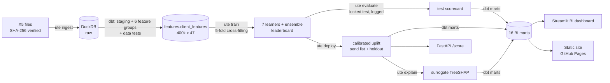

# uplift-targeting-engine

**Causal uplift modeling for promotion targeting.** It estimates how much an SMS promotion
*changes* each customer's chance of buying, texts only the customers for whom that change pays
for the message, and serves the results through a warehouse, an API and a BI dashboard.


**Live dashboard snapshot:** https://nirmalkumar31.github.io/uplift-targeting-engine/

Built on the public [X5 RetailHero](https://ods.ai/competitions/x5-retailhero-uplift-modeling)
randomised experiment: 400k loyalty-card holders, 45.8M purchase lines, and 200k clients of whom
a random half received the SMS.

## Why uplift, not response

A response model texts the people most likely to buy, and most of them would have bought
anyway. Uplift modeling targets the *persuadable*. On the locked test set the traditional
response model does **worse than random** (Qini −0.0054); the uplift model's top 10% respond
**+11.9pp** to the SMS, 3.6× the average effect.

## Results (locked test set, 40,008 clients, evaluated once after model selection)

| | Qini AUC [95% CI] | Uplift @10% | Uplift @30% | Profit / 1,000 clients* |
|---|---|---|---|---|
| **Champion: S-learner** | **+0.0164** [+0.0099, +0.0224] | **+11.9pp** [9.1, 14.6] | +6.3pp | **₽1,014** |
| Response model (traditional) | −0.0054 [−0.0109, +0.0001] | +0.9pp | +2.0pp | −₽435 |
| Random targeting | −0.0015 (noise band ±0.0065) | +2.9pp | +3.3pp | −₽35 |
| Text everyone | | | | ₽501 |

\*At the targeting depth chosen on development data (41%), SMS ₽3, margin ₽105 per extra purchase.
Targeting by uplift earns **2.0× texting everyone**; the response model loses money.

**Compared with the previous version of this project**
([PromoLift_AI](https://github.com/nishanth3112/PromoLift_AI)): test Qini **+0.0164 vs
+0.0078** (2.1×) and top-10% uplift **+11.9pp vs +9.0pp**, from richer warehouse features
(loyalty-points behaviour, short-window momentum, product mix). The two projects used different
random splits, so this is indicative rather than a paired comparison.

**Deployed campaign** (all 400,162 clients scored with the production model):
139,557 texted, 15,538 held out as a random control group, **7,371 expected extra purchases**,
expected profit **₽357,681 vs ₽200,025** for texting everyone.

### A leakage bug, caught and fixed

The first full run scored a test Qini of +0.031. That was too good to accept without a check, and
the check found the cause: `first_redeem_date` in `clients.csv` runs to **November 2019**, months
after the SMS, and the treated arm has more of these late redemptions. That makes it a
post-treatment variable. `stg_clients` now drops redemptions after the reference date, and a dbt
test (`no_future_dates`) fails the build if any feature input is dated after it. Every number
above comes from the corrected pipeline. `meta.test_access_log` records both test evaluations,
the leaky one and the fixed one; the model choice was made by the fixed out-of-fold rule each time.

## Architecture



| Layer | What it does |
|---|---|
| **Ingest** (`src/uplift_engine/ingest.py`) | download, SHA-256 check, typed load of 45.8M rows into DuckDB in ~18s |
| **Warehouse** (`dbt/`) | staging → 6 feature groups → `client_features`; 16 marts on top of model outputs; data tests on keys, ranges, accepted values and future dates |
| **Learners** (`models/learners.py`) | S, T, X, class-transformation and DR-learner on one LightGBM base, plus a top-k ensemble; response and random baselines |
| **Evaluation** (`evaluation/metrics.py`) | Qini AUC and uplift@k matching scikit-uplift to 10 decimal places, stratified bootstrap CIs, paired comparisons, random-ranking noise band |
| **Decision** (`policy.py`) | isotonic uplift calibration → per-client expected profit, a profit curve by depth, a sensitivity table, a 10% randomised holdout |
| **Monitoring** (`monitoring.py`) | covariate balance (randomisation check), PSI drift of the scoring population |
| **Serving** (`api.py`) | FastAPI: `/score` (features in, uplift and send decision out), `/clients/{id}`, `/model` |
| **BI** (`dashboard/`) | 7-page Streamlit app: executive overview, ROI simulator, segments, model performance, drivers, data health, send list |

Method details: [docs/methodology.md](docs/methodology.md).

## Quickstart

```bash
uv sync --all-extras          # Python 3.12
uv run ute run                # ingest -> dbt features -> train -> evaluate -> deploy -> explain -> dbt marts (~20 min)
uv run streamlit run dashboard/app.py   # BI dashboard, http://localhost:8501
uv run uvicorn uplift_engine.api:app    # scoring API, http://localhost:8000/docs
```

The exported marts are committed in `data/marts/`, so the dashboard runs straight after
`uv sync`, without the 600 MB download. Shortcuts live in the `Makefile` (`make pipeline`, `make dashboard`, `make api`, `make test`),
and `docker compose up --build` runs the dashboard and API in containers.

```bash
curl -s localhost:8000/score -H 'content-type: application/json' -d '{
  "clients": [{"client_id": "demo", "age": 64, "gender": "F", "n_txn": 6, "n_txn_60d": 3,
               "share_txn_express_spent": 0.3, "card_tenure_days": 400}]}'
```

Each stage also runs on its own: `ute ingest | transform | train | evaluate | deploy | explain | marts`.
Everything is configured in [`configs/pipeline.yaml`](configs/pipeline.yaml): learners, LightGBM
parameters, folds, bootstrap size, economics and drift thresholds.

## What drives uplift

A LightGBM surrogate reproduces the deployed scores (R² 0.98), and TreeSHAP attributes them:
**age** (11%), **visits in the last 60 days** (9%), **card tenure** (7%), and the **share of
purchases paid with promotional (express) points** (7%) lead. Older, less frequent shoppers who
have used promotions before are the most persuadable. Age is the top driver, so check whether
age-based targeting is acceptable for your campaign before you deploy.

## Testing and CI

```bash
uv run pytest          # 32 tests: metrics, learners, policy, drift, split, end-to-end pipeline, API
uv run ruff check . && uv run ruff format --check .
```

The end-to-end test runs `train → evaluate → deploy → explain` and the API against a synthetic
warehouse with a known treatment effect. GitHub Actions runs lint, tests and `dbt parse` on
every push.

## Limitations

- **Economics are assumptions** (SMS ₽3; margin = mean basket × X5's reported 24.6% gross margin).
  The ROI simulator recomputes the decision for any cost and margin.
- **One campaign, one snapshot.** The model learns how this SMS worked in early 2019; a live
  campaign should be checked against its holdout group before it is trusted.
- **The signal is modest.** Most of the value sits in the top 1-3 deciles, which is exactly where
  a targeted campaign spends its budget.

## Repository layout

```
configs/pipeline.yaml        every tunable in one place
src/uplift_engine/           ingest, data, learners, metrics, policy, monitoring, pipeline, cli, api
dbt/models/                  staging/ features/ marts/   (+ macros/ for custom data tests)
dashboard/                   Streamlit app (app.py + views/)
scripts/build_site.py        static dashboard snapshot -> docs/index.html (GitHub Pages)
data/marts/                  exported BI marts (parquet)
tests/                       pytest suite on synthetic data
```
