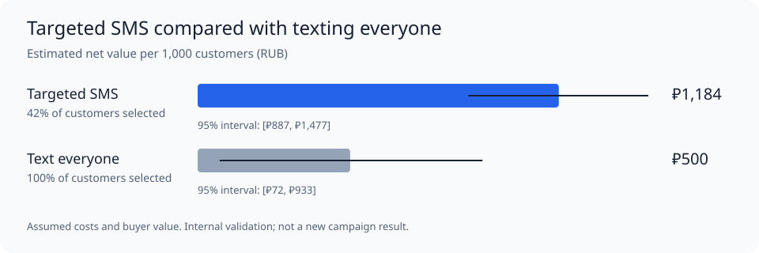

# SMS Campaign Targeting

Who should receive a marketing text?

This project uses the public **X5 RetailHero randomized SMS experiment** to estimate
which customer groups are more likely to buy because of a message. It compares
targeted outreach with texting everyone.

[View the dashboard](https://nirmalkumar31.github.io/uplift-targeting-engine/) ·
[Read the methods](docs/methodology.md)



## Main result

<!-- results:start -->
| Contact strategy | Customers selected | Estimated net value per 1,000 |
|---|---:|---:|
| Targeted SMS | 42% | ₽1,184 |
| Text everyone | 100% | ₽500 |

The targeted approach used **58% fewer messages** and had **2.4 times the estimated value** of texting everyone.

Internal validation on about 200,000 experiment customers. Assumptions: ₽3 per SMS and ₽105 per additional buyer. These are estimated incremental values, not revenue from a new campaign. [See uncertainty intervals and validation details](docs/results.md).
<!-- results:end -->

## How it works

1. Prepare purchase history and customer features using SQL, DuckDB, and dbt.
2. Estimate how the SMS changes purchase probability.
3. Select customers when the expected additional value covers the contact cost.
4. Compare the complete targeting approach with simple alternatives.
5. Publish the results in a dashboard and provide a scoring API.

## Run the dashboard

```bash
uv sync --locked --all-extras
uv run streamlit run dashboard/app.py
```

Python 3.12. The dashboard can use the result files included in the repo.
To reproduce the full analysis, run `uv run ute run`.

## Tools

Python, SQL, DuckDB, dbt, scikit-learn, LightGBM, Streamlit, Plotly, and FastAPI.

## Keep in mind

The campaign costs and value of an additional buyer are assumptions. The analysis was
validated internally on customers used in earlier exploration; a fresh randomized campaign
is needed to confirm the result. The reported intervals exclude model-fitting and selection
uncertainty. This project does not send messages.

- [Detailed results](docs/results.md)
- [Methods and limitations](docs/methodology.md)
- [Setup, architecture, and testing](docs/technical-reference.md)
- [Data source and terms](https://ods.ai/competitions/x5-retailhero-uplift-modeling)

Code is MIT-licensed; the dataset has its own terms.
